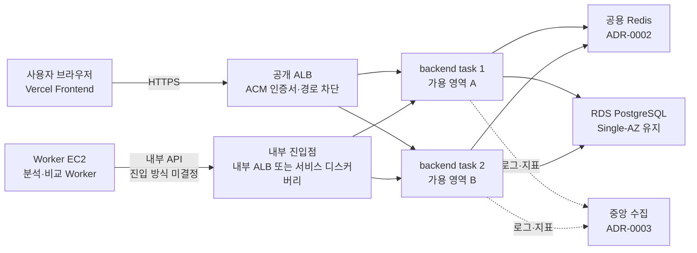

# ADR-0001: Java API를 ECS Fargate 다중 task와 ALB로 다중화한다

| 항목 | 내용 |
| --- | --- |
| 상태 | **제안 (초안)** |
| 작성일 | 2026-10-30 |
| 작성자 | mkshie |
| 관련 이슈 | [#336](https://github.com/catchhole-soma/catchhole-backend-java/issues/336), [#119](https://github.com/catchhole-soma/catchhole-backend-java/issues/119), [#280](https://github.com/catchhole-soma/catchhole-backend-java/issues/280) |
| 관련 ADR | [ADR-0002 공용 Redis](0002-shared-redis.md), [ADR-0003 중앙 로그·지표 수집](0003-central-logs-and-metrics.md) |

> 팀 검토 전 제안이다. 이 문서의 ECS·ALB 등 제품과 리소스는 채택이 확정되지 않았다. 운영의 현재 구조는 [Infrastructure Flow](../infrastructure-flow.md)를 기준으로 한다.

## 1. 배경

### 현재 구조 — 2026-10-30 저장소 기준

| 구성 | 현재 상태 | 근거 |
| --- | --- | --- |
| API 서버 | Amazon EC2 한 대에서 Caddy·backend·Redis 컨테이너를 함께 실행 | [compose.api.prod.yml](../../deploy/compose.api.prod.yml) |
| 공개 진입점 | Caddy가 HTTPS를 종료하고 `/actuator/health`를 제외한 `/actuator`를 404로 막는다. 공개 요청의 `traceparent`·`tracestate`·`baggage`를 지운 뒤 `backend:8080` 하나로 전달 | [Caddyfile](../../deploy/Caddyfile) |
| Worker 경로 | Worker가 Caddy를 거치지 않고 API 서버의 사설 `:8080`에 직접 연결 | [Caddyfile](../../deploy/Caddyfile) 주석, [Infrastructure Flow](../infrastructure-flow.md) |
| 배포 | GitHub Actions가 SSM으로 `docker compose up -d`를 실행해 단일 backend 컨테이너를 교체한 뒤 health를 확인 | [deploy-api-ec2.yml](../../.github/workflows/deploy-api-ec2.yml) |
| DB 연결 | API Hikari 최대 10·최소 유휴 2. 앱 전체 상시 연결 예산 29개, DB 일반 연결 상한 176개 | [application-prod.yml](../../src/main/resources/application-prod.yml), [RDS 자원·백업 알림](../../deploy/RDS_BACKUP_MONITORING.md) |
| 지표 | 모니터링 EC2의 Prometheus가 고정 대상 파일(`file_sd_configs`)로 API 사설 IPv4의 8081을 수집 | [prometheus.yml](../../deploy/monitoring/prometheus.yml), [모니터링 배포](../../deploy/MONITORING_DEPLOYMENT.md) |
| 로그 | 컨테이너 로그를 EC2 journald에 최대 14일 또는 1GB 보관. 중앙 수집 없음 | [compose.api.prod.yml](../../deploy/compose.api.prod.yml), [README](../../README.md), [Infrastructure Flow](../infrastructure-flow.md) |

### 문제

- API EC2 한 대가 장애가 나면 공개 API와 Worker 내부 API가 함께 중단된다. Frontend는 Vercel에서 계속 열리지만 API를 호출하는 기능은 모두 실패한다.
- Worker는 5분 lease로 실행 중 Job을 다시 회수하므로 Job 자체를 잃지는 않는다. 하지만 API가 없는 동안에는 claim·heartbeat·토큰 정산을 할 수 없다. 2026-10-21 배포 구간에서 정산 요청이 실패한 사례가 [#280](https://github.com/catchhole-soma/catchhole-backend-java/issues/280)에 기록돼 있다.
- 계획된 배포 중의 연결 공백은 #280이 다룬다. 이 ADR은 **서버 장애에 대한 대응**을 다루며 #280을 대체하지 않는다. 두 작업의 관계는 6절에 정리한다.

### 범위 밖

- RDS 가용성. Single-AZ를 유지하므로 DB 장애는 이 결정으로 해결되지 않는다.
- Worker 서버 다중화와 Worker rollout.
- 멀티 리전, IaC 도입. 필요하면 별도로 판단한다.

## 2. 판단 기준

1. 서버 하나 또는 가용 영역 하나가 장애일 때 공개 API와 Worker 내부 API가 계속 응답한다.
2. 계획된 배포에 기인한 연결 실패가 0건이다. #280과 같은 목표다.
3. 소규모 팀이 운영할 수 있는 복잡도다. 서버 패치와 용량 관리를 줄인다.
4. 월 비용이 팀 예산 안에 있다. 9절에 따라 산정이 필요하다.
5. 기존 관측 스택(Prometheus·Grafana·Tempo)과 이어진다.

**결정 전에 필요한 입력**: [#119](https://github.com/catchhole-soma/catchhole-backend-java/issues/119)는 허용 중단 시간과 월 비용으로 API 다중화의 필요성을 결정하도록 정했다. 허용 중단 시간 목표는 아직 합의되지 않았다. 목표가 길게 정해지면 대안 A가 합리적일 수 있다.

## 3. 검토한 대안

| 대안 | 장점 | 단점 | 판단 |
| --- | --- | --- | --- |
| A. EC2 한 대 유지 + 복구 강화 | 추가 비용이 거의 없고 현재 구조를 그대로 쓴다 | 서버 장애 시 복구할 때까지 중단된다. 이전 버전 복구 시간도 아직 검증 전이다([#176](https://github.com/catchhole-soma/catchhole-backend-java/issues/176)) | 허용 중단 시간이 길면 채택 |
| B. EC2 두 대 이상 + ALB | Compose 배포 방식과 호스트 제어를 유지한다 | 서버 패치·용량·여러 대 배포 순서를 팀이 직접 운영한다 | 운영 부담이 C보다 크다 |
| C. **ECS Fargate + ALB (제안)** | 서버를 관리하지 않는다. 지정한 task 수를 ECS가 유지하고 죽은 task를 교체한다. rolling 배포와 실패 시 자동 rollback을 제공한다 | task definition·target group·IAM 학습이 필요하다. 네트워크 구성에 따라 NAT 비용이 생긴다. 로그·지표 수집 경로를 새로 만들어야 한다 | 제안 |
| D. EKS | 가장 유연하고 다른 환경으로 옮기기 쉽다 | 클러스터 관리비가 시간당 USD 0.10(표준 지원 기준) 추가된다. Kubernetes 운영 지식이 필요하다 | 현재 규모에 과하다 |

Infrastructure Flow의 Compute Platform 비교에 있는 "EC2 Auto Scaling + Load Balancer"는 B에 포함한다.

## 4. 제안하는 결정

ECS Fargate 서비스로 backend task를 **두 개 이상, 서로 다른 가용 영역에** 실행하고, ALB가 공개 요청을 정상 task에만 나눠 보낸다.

### 4.1 구성

### 4.2 세부 결정

| 항목 | 제안 | 이유 |
| --- | --- | --- |
| task 수·배치 | 최소 2개, 서로 다른 가용 영역 | 한 task 또는 한 가용 영역 장애를 견디기 위한 최소 구성 |
| task 크기 | 현재 API 서버 기준(2 vCPU, JVM 힙 최대 768MiB)에서 시작해 측정 후 조정 | 현재 값은 [대시보드 문서](../../deploy/monitoring/grafana/dashboards/README.md)와 [모니터링 배포](../../deploy/MONITORING_DEPLOYMENT.md) 기준. task 크기별 처리량은 미측정 |
| 배포 | ECS rolling update(`minimumHealthyPercent=100`, `maximumPercent=200`)와 deployment circuit breaker 자동 rollback | 새 task가 정상이 된 뒤 옛 task를 줄인다. 실패하면 이전 task definition으로 돌아간다 |
| 트래픽 health | ALB 대상 health에는 DB·Redis 같은 외부 의존성을 넣지 않은 readiness 전용 경로를 쓴다. 현재 `/healthz`는 알림과 배포 후 확인 용도로 유지한다 | 현재 `/healthz`는 `management.endpoint.health.group.deployment.include: "*"`라 DB·Redis health를 포함한다. 그대로 쓰면 Redis 장애가 인증 기능 장애로 끝나지 않고, 모든 task가 비정상 판정을 받아 교체가 반복될 수 있다 |
| 종료 순서 | ALB deregistration delay(기본 300초), ECS `stopTimeout`(기본 30초, Fargate 최대 120초), Spring graceful shutdown 단계 제한(기본 30초)을 가장 긴 정상 요청에 맞춰 함께 정한다 | ECS는 task를 멈추기 전에 대상에서 빼고 drain한 뒤 종료 신호를 보낸다. 세 값이 어긋나면 업로드처럼 긴 요청이 중간에 끊긴다 |
| 공개 진입점 | HTTPS는 ALB와 ACM 인증서, `/actuator` 차단은 ALB listener rule로 옮긴다. 공개 요청의 Trace Context 제거는 ALB에서 같은 처리가 가능한지 확인한다 | Caddy의 기존 보호 정책을 유지하기 위함. 앱 필터로 대신하면 Java Agent가 필터보다 먼저 context를 읽을 수 있어 별도 검증이 필요하다 |
| Worker 내부 진입점 | 내부 ALB와 서비스 디스커버리(Cloud Map DNS)를 비교해 결정한다. #280의 Worker 경로 작업과 맞춘다 | task IP는 교체될 때마다 바뀌므로 사설 `:8080` 직결을 유지할 수 없다 |
| 비밀값 | 서버의 `api.env` 대신 SSM Parameter Store 또는 Secrets Manager를 task definition의 `secrets`로 주입한다 | Infrastructure Flow가 약점으로 기록한 "비밀값 수동 관리"도 함께 줄어든다 |
| 이미지 | 현재 GHCR 이미지를 private registry 인증으로 가져올지, ECR로 옮길지 비교한다 | Infrastructure Flow 5.3의 container registry 결정 항목 |
| 네트워크 | private subnet + NAT Gateway와, public subnet + 공인 IPv4(보안 그룹으로 ALB에서 오는 요청만 허용)를 비용으로 비교한다. S3는 gateway endpoint로 NAT를 거치지 않게 한다 | API는 SMTP·SOLAPI·Discord·이미지 레지스트리에 외부 연결이 필요하다 |
| 스케줄러 | 다중 실행 전에 `@Scheduled` 작업을 "여러 task가 나눠 처리(SKIP LOCKED)", "한 task만 실행(DB 잠금 기반)", "그대로 두어도 안전"으로 분류하고 보호를 적용한다 | 5절 참고 |
| DB 연결 예산 | 상시 API 2 task면 API 20개(앱 전체 39개), rolling 배포 중 최대 4 task면 API 40개(앱 전체 59개)로 다시 계산하고 경보 기준을 갱신한다 | 일반 상한 176개 안이지만 [연결 예산 문서](../../deploy/RDS_BACKUP_MONITORING.md)의 29개 기준이 바뀐다 |
| Redis | [ADR-0002](0002-shared-redis.md) | 서버 간 인증 데이터 공유 |
| 로그·지표 | [ADR-0003](0003-central-logs-and-metrics.md) | 서버 접속 없이 조회하고 task 교체 후에도 수집 |

## 5. 결과

### 좋아지는 점

- task 하나 또는 가용 영역 하나가 장애가 나도 ALB가 남은 task로 요청을 보내고, ECS가 지정한 개수를 맞추기 위해 새 task를 띄운다.
- rolling 배포로 #280의 배포 공백 문제도 같은 구조에서 해결할 수 있다.
- 비밀값이 서버 파일에서 관리형 저장소로 옮겨진다.

### 대가

- 월 비용이 늘어난다: ALB, Fargate task 두 개 이상, ElastiCache, NAT Gateway 또는 공인 IPv4, 로그 저장. 금액은 9절에 따라 산정이 필요하다.
- task definition, target group, 서비스 배포 설정, IAM 역할 같은 운영 지식이 필요하다.
- 서버에 접속해 로그를 보는 방식이 사라지므로 로그·지표 수집 경로를 먼저 만들어야 한다.

### 새로 생기는 위험

- health 설정을 잘못하면 외부 의존성 장애가 task 교체 반복으로 번진다(4.2).
- **스케줄러 중복 실행.** 코드를 읽은 결과이며 다중 실행 테스트는 하지 않았다.
  - 작품·회차 원문 정리 작업은 대상 행을 `FOR UPDATE`로 잠가 같은 건의 동시 처리를 막는 구조로 보인다(예: [WorkPurgeRequestRepository](../../src/main/java/org/monitoring/catchholebackend/domain/work/repository/WorkPurgeRequestRepository.java)). 다만 다른 task가 잠금을 기다리는 동안 DB 연결을 점유한다.
  - 분석 실패 알림은 이미 `FOR UPDATE SKIP LOCKED`로 여러 실행자가 나눠 처리한다([AnalysisFailureNotificationRepository](../../src/main/java/org/monitoring/catchholebackend/domain/analysis/repository/AnalysisFailureNotificationRepository.java)).
  - DB snapshot 지표([AnalysisMetricsScheduler](../../src/main/java/org/monitoring/catchholebackend/domain/analysis/processor/AnalysisMetricsScheduler.java), [ServiceUsageMetricsScheduler](../../src/main/java/org/monitoring/catchholebackend/global/monitoring/ServiceUsageMetricsScheduler.java))는 task마다 같은 조회를 반복하고 같은 값을 보고한다.
- **Flyway.** 여러 task가 동시에 기동해도 Flyway가 DB 잠금으로 migration을 직렬화하지만, migration 중에도 옛 버전 task가 같은 schema를 사용한다. 호환되지 않는 migration은 무중단 적용 대상으로 취급하지 않는다(#280과 같은 원칙).
- RDS가 Single-AZ이므로 DB 장애는 여전히 전체 중단이다.

## 6. #280과의 관계

| 작업 | #280 배포 전환 | 이 ADR 서버 장애 대응 | ECS 채택 시 |
| --- | --- | --- | --- |
| 트래픽용 readiness 분리 | 필요 | 필요 | 그대로 재사용 |
| drain·graceful shutdown | 필요 | 필요 | 제한 시간만 ECS·ALB 설정으로 옮김 |
| 스케줄러 중복 실행 방지 | 두 버전이 겹칠 때 필요 | 항상 필요 | 그대로 재사용 |
| 공유 Redis | 두 버전이 겹칠 때 필요 | 필수 | 그대로 재사용 |
| DB 연결 예산 | 중첩 기동 구간 | 상시와 배포 중 | 그대로 재사용 |
| 한 서버 안의 트래픽 전환 (Caddy upstream 등) | 필요 | 불필요 | ALB·ECS가 대체 |

마지막 행을 빼면 #280의 작업 대부분이 ECS 채택 후에도 재사용된다. 그래서 #280을 먼저 진행해도 낭비가 크지 않다. 두 작업의 검증 결과는 #280처럼 서로 구분해 기록한다.

## 7. 전환 계획 (채택 시)

1. **현재 EC2에서 선행 작업.** readiness 경로 분리, 스케줄러 분류와 보호, 공용 Redis([ADR-0002](0002-shared-redis.md)), 로그·지표 수집([ADR-0003](0003-central-logs-and-metrics.md))을 서버 한 대 상태에서 하나씩 적용하고 검증한다.
2. **병행 구성.** ECS 서비스와 ALB를 기존 EC2와 나란히 만들고 검증 환경에서 먼저 확인한다.
3. **공개 트래픽 전환.** DNS를 단계적으로 전환한다. 가중치 전환 지원 여부는 DNS 제공자를 확인해야 한다. 문제가 생기면 DNS를 기존 EC2로 되돌린다. Worker 내부 경로는 공개 경로와 별도 단계로 전환한다.
4. **장애 훈련 후 정리.** 8절 검증을 통과한 뒤 기존 API EC2를 정리한다.

## 8. 검증 기준

합의한 검증 환경과 부하에서 k6로 공개 요청과 Worker 내부 요청을 계속 보내면서 다음을 기록한다. 측정하지 않은 항목으로 완료를 선언하지 않는다.

| 시나리오 | 목표 | 기록할 값 |
| --- | --- | --- |
| task 하나 강제 종료 | 남은 task가 계속 응답한다. 강제 종료된 task에서 처리 중이던 요청은 따로 집계한다 | 연결 실패·5xx 수, 대체 task 정상화 시간 |
| 계획된 배포 | 배포에 기인한 연결 실패 0건 | 요청 수, 실패 수, 전환 시간 |
| 배포 실패 | 기존 task가 계속 응답하고 자동 rollback된다 | rollback 시간, 실행 task definition |
| Redis 중지 | 인증 API만 실패하고 다른 API와 ALB 대상 health는 유지된다 | API별 성공률, 대상 health 상태 |
| 상태 변경 요청 | 정산·진행 갱신·완료가 중복 반영되거나 유실되지 않는다 | 응답과 DB 최종 상태 |

## 9. 미결정·미확인

| 항목 | 상태 |
| --- | --- |
| 허용 중단 시간 목표 | 미합의 |
| 월 비용 | 미산정. AWS 요금표 기준으로 산정 필요 |
| API 컨테이너 기동 시간 | 미측정. #280 사례에서 기존 API 종료 시작부터 새 Tomcat 기동 로그까지 45.600초가 관측됐지만, 가용성 공백을 측정한 값은 아니다 |
| task CPU·메모리 크기 | 미결정 |
| Worker 내부 진입점 | 미결정 (내부 ALB / 서비스 디스커버리) |
| 공개 Trace Context 제거 방법 | ALB 지원 여부 확인 필요 |
| 이미지 레지스트리 | 미결정 (GHCR 유지 / ECR) |
| 네트워크 구성 | 미결정 (NAT Gateway / 공인 IPv4) |
| 스케줄러별 다중 실행 안전성 | 코드만 읽음, 테스트 미실시 |

## 10. 참고

- [Infrastructure Flow](../infrastructure-flow.md) — 현재 구조, 단일 장애점, Compute Platform 비교, 5.3 후속 후보
- [#280](https://github.com/catchhole-soma/catchhole-backend-java/issues/280) — Java API 배포 중 공개·Worker 요청 유지
- [#119](https://github.com/catchhole-soma/catchhole-backend-java/issues/119) — 운영 안정화 Epic, 후속 후보 "API 다중화"
- [RDS 자원·백업 알림](../../deploy/RDS_BACKUP_MONITORING.md) — 연결 예산 29개와 DB 한도
- [Amazon ECS deployment circuit breaker](https://docs.aws.amazon.com/AmazonECS/latest/developerguide/deployment-circuit-breaker.html)
- [ALB 대상 그룹 health check](https://docs.aws.amazon.com/elasticloadbalancing/latest/application/target-group-health-checks.html)
- [Amazon EKS 요금](https://aws.amazon.com/eks/pricing/)
- [Spring Boot Actuator endpoints](https://docs.spring.io/spring-boot/reference/actuator/endpoints.html) — health group, liveness·readiness
