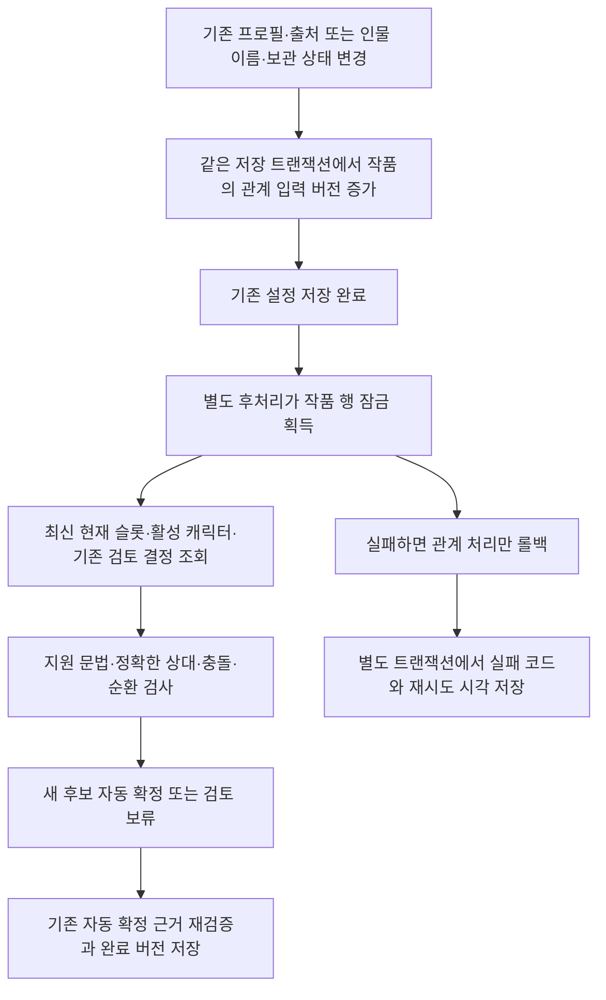

# 현재 설정의 가족 관계 처리 v1 — GH260

[#260](https://github.com/catchhole-soma/catchhole-backend-java/issues/260)은 이미 현재 프로필에 반영된 가족 관계를 읽어 [#259 관계 모델](family-relationships-v1.md)에 연결한다. 기존 추출 프롬프트·출력 스키마·LLM 호출·토큰 차감은 변경하지 않는다. 별도 규칙 후처리에서 명확한 새 명제를 자동 연결하고, 모호한 명제는 후보 검토로 남긴다. 원문 전체나 CharacterFact 이력에서 관계를 다시 추출하지 않는다.

## 입력과 지원 문법

입력은 활성 캐릭터의 실제 현재 PROFILE 슬롯과 `CharacterSnapshotSource`에 함께 남아 있는 Fact다. `RelationshipSourceResolver`가 제공하는 전체 `{factValue, valueJson}`와 해당 슬롯의 모든 출처를 사용한다. 여러 Fact가 한 슬롯에 기여하면 예전 Fact 문자열 각각을 파싱하지 않고 현재 슬롯을 한 번만 읽는다. 직접 수정한 현재 설정도 같은 경계를 사용한다.

`ExplicitFamilyRelationshipParser`는 `factValue`와 문자열 `valueJson`, 또는 `valueJson.value`만 읽는다. 같은 두 표현은 한 번만 파싱한다. 두 표현이 다르면 `CURRENT_VALUE_CONFLICT`로 보류하며, 그중 하나를 임의로 선택하지 않는다. 직접 편집 API가 저장하는 `valueJson={value, name}`도 지원한다. `name`은 비어 있지 않은 문자열이며 마지막 `.` 뒤 factKey suffix의 `_`를 공백으로 바꾸고 공백을 축약한 표시명과 같거나, `family`·`가족`·`가족 관계`·`가족관계` 중 하나여야 한다. 키와 일치해도 추정·추측·불확실·소문·비유·부정·거짓·가능성·가설·의심·믿음이나 과거·예정 등의 알려진 확실성/시점 한정어가 들어 있으면 보류한다. `name`에서 관계 명제나 상대를 추출하지 않는다. 불일치·비문자 표시명, `value`와 허용된 `name` 외 속성, 지원하지 않는 구조는 그 의미를 생략한 채 자동 처리하지 않고 `UNSUPPORTED_STRUCTURED_CONTEXT`로 보류한다. 원문 인용, 임의 중첩 JSON, 과거 Fact는 파서 입력이 아니다.

| 현재 설정 예시 | 파서 결과 | 후처리 판단 |
| --- | --- | --- |
| `아버지: 홍길동` / `어머니는 홍길동` | 본인 CHILD_OF 홍길동 | 유일한 활성 상대와 나머지 검증이 맞으면 새 후보 자동 확정 |
| `홍길동의 아들` / `홍길동의 딸이다.` | 본인 CHILD_OF 홍길동 | 소유격의 역할은 본인의 역할로 읽음 |
| `아들: 홍길동` / `홍길동의 아버지` | 본인 PARENT_OF 홍길동 | 상대 역할 표기와 소유격의 방향을 구분 |
| `남편은 김철수` / `아내: 김철수` | SPOUSE | 한쪽 프로필의 명시적 주장으로 대칭 관계 생성 가능 |
| `홍길동의 형제` / `자매: 홍길동` | SIBLING, UNSPECIFIED | 부모를 만들거나 친생 여부를 추정하지 않음 |
| `친아버지: 홍길동` / `홍길동의 친형제` | BIOLOGICAL | 친형제라는 이유로 FULL을 추정하지 않음 |
| `양부: 홍길동` / `의붓어머니: 홍길동` | ADOPTIVE / STEP | 입력의 세부 유형 보존 |
| `홍길동의 이복형제` / `이부자매: 홍길동` | HALF | 부모의 정체나 성별을 역산하지 않음 |
| 키 `profile.아버지` 또는 `profile_family/아버지`, 값 `홍길동` | CHILD_OF | 알려진 prefix 뒤의 전체 항목명이 지원 역할과 일치할 때만 보완 |
| 키 `profile.전_남편`, 값 `홍길동` | SPOUSE, HISTORICAL | `_`는 항목명 내부 공백이며 `전 남편` 전체 역할을 보존 |
| 키 `profile.과거_아버지` / `profile.추정_아버지`, 값 `홍길동` | 미지원 | 앞의 한정어를 버리고 마지막 `아버지`만 역할로 사용하지 않음 |
| 키 `profile.추정_아버지`, 값 `아버지: 홍길동` | UNCERTAIN | 완결된 값도 키의 미지원 한정어를 무시해 자동 확정하지 않음 |
| `홍길동의 아들이 아니다` | NEGATED | 검토 후보, 자동 확정 금지 |
| `아버지: 홍길동 (추정)` / `남편은 김철수?` | UNCERTAIN | 검토 후보, 자동 확정 금지 |
| `홍길동의 아버지 같은 존재` | FIGURATIVE | 검토 후보, 자동 확정 금지 |
| `오빠: 홍길동` / `홍길동의 동생` | UNCERTAIN, AMBIGUOUS_FAMILY_ROLE | 친족 외 호칭으로도 쓰이므로 검토 필요 |
| `전 남편: 김철수` / `과거 김철수의 배우자` | HISTORICAL | 명확하면 과거 관계로 확정할 수 있으나 현재 가계도에는 노출하지 않음 |
| `홍길동의 아들이며 김철수의 형제` | 미지원 | 일부 문장만 골라 관계로 만들지 않음 |
| `아버지: 그 사람` / `아버지: 미상` | 미지원 | 대명사나 미상 호칭을 실제 이름으로 연결하지 않음 |

현재 설정 편집 API는 `profile.<항목명>` 형태를 사용하며, `CharacterServiceImpl.normalizeSettingKey`는 항목명의 공백을 `_`로 저장하고 `keySuffixDisplayName`은 이를 공백으로 표시한다. 따라서 파서는 `_`를 namespace 구분자로 사용하지 않는다. `profile.`와 기존 공유 fixture의 `profile_family/` prefix만 제거한 뒤 전체 항목명의 `_`를 공백으로 복원한다. 항목명 내부의 추가 `.`나 `/`도 버리지 않는다. 지원 역할과 정확히 일치하는 `전 남편`은 기존 과거 역할을 사용하고, `과거 아버지`·`추정 아버지` 같은 미지원 가족 항목명은 `UNSUPPORTED_FAMILY_SYNTAX`로 보류한다. 값이 단순 이름이면 유형을 추측해 후보를 만들지 않으며, 값 자체에 완결된 명제가 있더라도 해당 보류 사유를 유지한다. `valueJson.name="family"` 같은 일반 표시명도 키의 한정어를 취소하지 않는다. `profile_아버지`처럼 알려진 prefix가 아닌 문자열을 마지막 `_`에서 나누는 동작은 지원하지 않는다.

문법은 전체 명제에 일치해야 한다. 줄바꿈과 세미콜론은 명제 구분자로 지원한다. 쉼표 목록, 접속절, 복잡한 소유격, 임의의 시점 표현은 추론하지 않는다. 나뉜 문장 중 해석하지 못한 부분이 있으면 이미 파싱한 명제도 `UNSUPPORTED_FAMILY_SYNTAX`로 보류한다. 예를 들어 `아버지: 홍길동; 사실은 그렇지 않다`에서 앞부분만 자동 확정하지 않는다. 의형제와 만남·동행·감정 표현은 가족 관계를 만들 근거가 아니다.

표현 채널 하나당 4,096자, 구분된 명제 20개를 넘으면 전체를 보류한다. 출처가 20개를 넘는 슬롯도 앞의 20개만 잘라 쓰지 않는다. 가족 표현은 있으나 명제를 만들 수 없는 슬롯은 `unsupportedSourceCount` 안내 대상이며, 임의 유형의 후보를 만들지 않는다. 이 수치가 0이라고 모든 한국어 가족 서술을 해석했다는 뜻은 아니다. 지원 문법 밖 표현의 의미적 재현율은 측정하지 않았다.

파서 결과와 문법 예시는 [공유 fixture](contracts/family-relationship-processing-v1.json)의 32개 합성 사례와 `ExplicitFamilyRelationshipParserTest`가 함께 검증한다. fixture는 이름 연결·소유권·순환 검증 이전의 문법 계약이다.

## 정확한 상대 연결과 자동 확정

파서는 캐릭터 ID를 선택하지 않고 상대 호칭을 반환한다. 후처리는 같은 작품의 활성 캐릭터 중 앞뒤 공백을 제거한 이름이 정확히 일치하는 사람을 찾는다. 내부 공백·대소문자·별칭·유사 이름을 정규화하거나 추정하지 않는다. 일치 0명은 UNRESOLVED_TARGET, 여러 명은 AMBIGUOUS_TARGET, 자기 자신은 SELF_REFERENCE로 검토한다.

다음 조건을 통과한 **이번 처리에서 처음 만들어진 후보**만 자동 확정한다.

1. 현재 프로필과 출처 토큰이 유효하고 파서가 전체 명제를 지원한다.
2. 단정된 관계이고 상대가 정확히 한 명으로 연결된다. UNKNOWN 시점·부정·비유·불확실성은 보류한다.
3. 동일한 관계·시점에 대한 명시적 긍정과 부정의 충돌이 없고, 현재 부모 그래프와 이번 처리 후보를 합쳐도 순환하지 않는다.
4. 같은 정규화 관계가 이전에 철회된 이력이 없다. 철회한 관계는 새 출처가 생겼다는 이유만으로 자동 복원하지 않는다.

부모/자녀 방향과 배우자/형제의 대칭 정규화, 세부 유형·서사 시점의 구분은 #259 규칙을 그대로 사용한다. 모르는 부모 생성, 최대 부모 수 제한, 형제로부터 부모 역산, 감정의 양방향 추정은 하지 않는다. 사람 검토 없이 일반 자연어의 모든 모순을 판별하는 기능은 아니다.

후보의 `origin=CURRENT_SETTING_RULE`과 `automaticallyConfirmed`로 생성·확정 경로를 구분한다. 사용자가 만든 후보는 `origin=MANUAL`이며 기존 명시적 확정 API를 유지한다. 자동 처리의 검토 사유는 후보 `reviewReasons`에 함께 노출한다.

## 저장 이후의 별도 처리와 버전

### 상세 처리 기준

- PROFILE 출처 교체·병합·제거, 캐릭터 발견/연결과 이름 변경·보관·복구에서 `works.relationship_input_version`을 증가시킨다. 관계 후처리 때문에 기존 설정 저장이나 분석 완료를 롤백하지 않는다.
- `relationship_processing_states`는 작품별 처리 완료 버전, 시도 버전, 완료 시각, 정제된 실패 코드, 재시도 시각 및 마지막 처리 집계를 저장한다. 모든 처리 쓰기는 기존 설정 변경과 같은 Work 행 잠금을 사용한다.
- 스케줄러는 기본 10초 간격으로 최대 10개 대기 작품을 처리한다. 실패한 작품은 기본 1분 뒤 재시도하며, 더 새로운 입력 버전은 이전 실패의 대기를 넘어서 처리할 수 있다. 이 설정은 처리량 또는 완료 시간 보장이 아니다.
- 대기 작품 조회에서 작품 ID와 입력 버전을 함께 읽고, 처리와 별도 실패 기록에 같은 버전을 전달한다. Work 잠금 획득 전에 입력이 바뀌면 해당 큐 항목은 건너뛰고 다음 조회가 새 버전을 처리한다. 처리 롤백/커밋 실패 이후 새 설정이 저장됐거나 같은 버전의 다른 처리가 이미 완료됐다면 늦은 실패 기록은 무시한다. 새 입력을 시도하지도 않고 FAILED로 표시하거나 이전 실패의 재시도 대기에 묶지 않는다.
- 원래 설정·출처·명제가 같은 규칙 후보의 요청 ID는 재실행해도 같다. 실제 상대 연결 결과를 이 ID에 넣지 않아, 상대가 나중에 등록되거나 동명 수가 달라져도 새 후보를 만들어 이전 검토 결정을 우회하지 않는다.
- 기존 PENDING 후보는 자동 확정하지 않는다. 처음 미해결이던 상대가 나중에 등록돼도 기존 후보의 연결·명제를 자동 수정하지 않으며 사용자가 확인해야 한다. 사용자가 수정·확정·제외한 동일 입력 후보도 덮어쓰거나 되살리지 않는다.
- 기존 자동 확정 후보는 새로 확정하지 않고 현재 이름 연결, 명시적 충돌과 순환을 다시 검사한다. 유효하지 않으면 검토 사유를 기록하며 이전 관계와 근거 이력은 보존한다.
- 프로필 입력이나 인물 상태가 바뀌면 기존 자동 근거의 `validatedInputVersion`은 최신 작품 버전보다 뒤처진다. 재검증 완료 전에는 그 근거를 유효한 자동 지지로 사용하지 않는다. 원래 토큰이 같은 자동 관계도 재처리 대기 중에는 REVIEW_REQUIRED가 될 수 있다. 수동 확정 근거는 자동 버전 대기 때문에 차단하지 않는다.
- 입력 내용이나 출처 집합이 실제로 바뀌면 다른 규칙 후보가 만들어질 수 있다. 동일 입력의 사용자 결정 보호가 앞으로 들어오는 모든 다른 설정까지 일괄 제외한다는 뜻은 아니다.
- 기존 데이터는 배포 즉시 원문을 전수 분석하지 않는다. 현재 설정 변경이나 사용자의 처리 요청으로 작품 단위 후처리를 시작한다.

자동 후보 하나의 입력 출처는 해당 현재 슬롯에 기여한 Fact 전체다. 원문 `hasEvidence`와 관계 근거의 현재성은 별개다. 원문 파기로 인용이 없어져도 현재 값과 출처가 남아 있으면 관계 해석 입력은 유지된다. 현재 설정에서 빠진 과거 Fact는 원문이 남아 있더라도 새 관계 생성 입력으로 쓰지 않는다. 원문 보기·파기·보관 캐릭터의 조회 제한은 기존 Fact evidence API를 따른다.

## API와 검토 화면 연결

모든 API는 JWT와 작품 소유권을 요구한다. 처리 API는 `/api/v1/works/{workId}/relationship-processing`이다.

| 메서드 | 결과 |
| --- | --- |
| GET | `NEVER_PROCESSED`, `PENDING`, `SUCCEEDED`, `FAILED`와 현재/완료 버전, 완료 시각, 실패 코드, 재시도 시각 및 집계 |
| POST | 현재 설정의 처리를 요청하거나 실패 후 재시도. 이미 대기 중이면 같은 대기를 공유하며 AI 재분석을 시작하지 않음 |

`autoConfirmedCount`는 마지막 처리에서 **새로 자동 확정한 후보 수**이며, 작품 전체 관계 수가 아니다. `reviewRequiredCount`는 마지막 처리에서 현재 설정과 대응된 PENDING 후보 수다. `unsupportedSourceCount`는 가족 표현을 발견했지만 후보로 해석하지 못했거나 출처 상한을 넘은 슬롯 수다. 실제 검토 상태·상대·명제는 기존 `/relationship-candidates` 목록과 상세를 기준으로 조회한다.

검토 화면은 처리 상태·근거·보류 사유를 표시하고, 필요한 경우 상대와 관계 명제를 수정한 뒤 기존 수정/확정/제외 API를 사용한다. stale 토큰이나 버전 충돌이 나면 최신 후보와 source API를 다시 읽는다. 사용자가 처리 버튼을 다시 눌러도 기존 대기 후보가 자동으로 해결되는 것은 아니다. 자동 확정 후보는 기존 `/relationships`에서 읽으며, 후처리 대기/검토 관계를 현재 가계도에 노출하지 않는 `visibleInFamilyTree` 계약을 유지한다. 그래프 배치와 가계도 화면은 #261에서 담당한다.

## 검증 범위

순수 파서 테스트는 역할 방향, 세부 유형, 부정·추정·비유, 대명사, 두 현재값 채널의 충돌, 미지원 문맥, 중첩 JSON 미접근 및 입력 한도를 검증한다. 공통 fixture 32건도 같은 production 파서로 실행한다. 통합 테스트는 현재 설정 저장의 버전 전달, 규칙 후보 생성·재처리·사용자 결정 보호, 이름 연결 변화, 충돌·순환, 자동 근거 재검증과 실패 복구를 검증한다. 실행 결과와 PostgreSQL/Flyway 적용 확인은 실제 완료한 검증 기록을 기준으로 보고한다. 이 문서 자체가 모든 문법의 의미 정확도나 대규모 작품의 처리 성능을 보장하지 않는다.

### 2026-10-17 실행 기록

- JDK 21에서 `./gradlew test bootJar --console=plain` 성공. 전체 3,234건 중 2,998건 통과, 기존 조건부 테스트 236건 skip, 실패·오류 0건이다. 관계 패키지 206건은 모두 실행해 통과했다.
- `RelationshipProcessingPostgresIntegrationTest`는 별도 Testcontainers PostgreSQL에서 Flyway V1–V85와 JPA `validate`를 적용하고 처리·실패 롤백·재시도·철회 보호를 검증했다. 기존 설정 저장 트랜잭션은 관계 후처리 실패에도 유지됐다.
- 별도로 만든 로컬 PostgreSQL과 실제 서버에서도 V1–V85 적용 및 기동을 확인했다. 공개 프로필 PATCH가 저장한 `{value, name}` 형식에서 명확한 배우자 관계는 자동 확정되고, 상대 미등록 부모 관계는 PENDING으로 남았다. 합성 인물과 설정을 사용했으며 LLM을 호출하지 않았다.

### 2026-10-19 리뷰 보완 검증

- 항목명 전체의 과거·추정 문맥을 보존하고, 값이 완결된 문장이어도 키의 한정어를 무시하지 않는 파서 회귀 25건을 추가했다. 현재 공유 fixture는 32건이다.
- H2와 PostgreSQL 각각에서 실제 후처리 쓰기 후 롤백 → 새 프로필 커밋 → 늦은 실패 기록, 오래된 큐 항목, 최신 실패·성공 보호를 검증했다. 스케줄러 단위 테스트는 서비스 호출의 커밋 예외에도 같은 입력 버전으로 실패를 기록하고 다음 작품을 처리하는지 확인한다.
- JDK 21의 `./gradlew test bootJar --console=plain` 성공. 전체 3,266건 중 3,030건 통과, 기존 조건부 테스트 236건 skip, 실패·오류 0건이다. 관계 패키지 238건은 모두 실행해 통과했다. API 응답 계약과 Flyway schema는 바꾸지 않았다.
