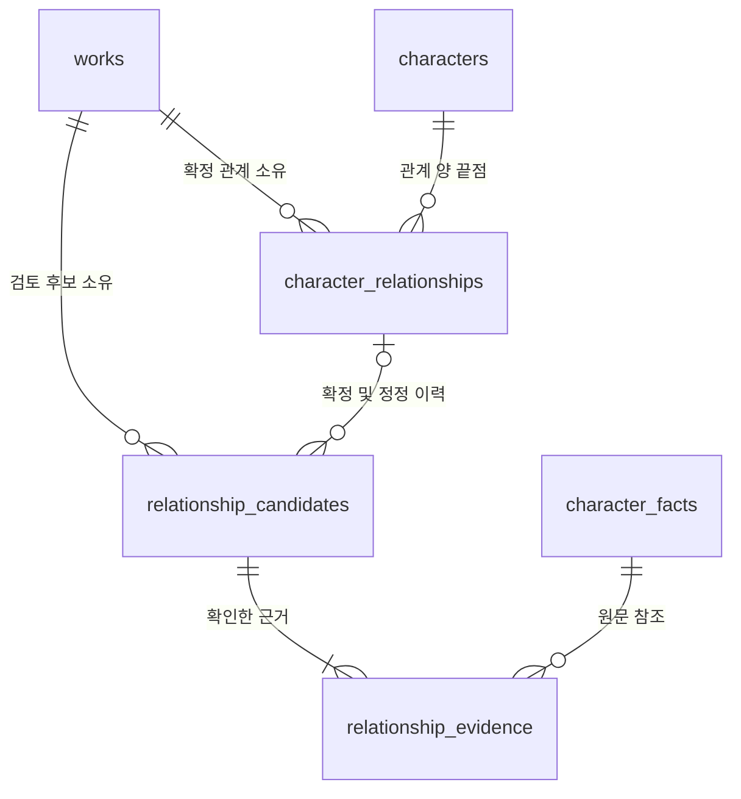
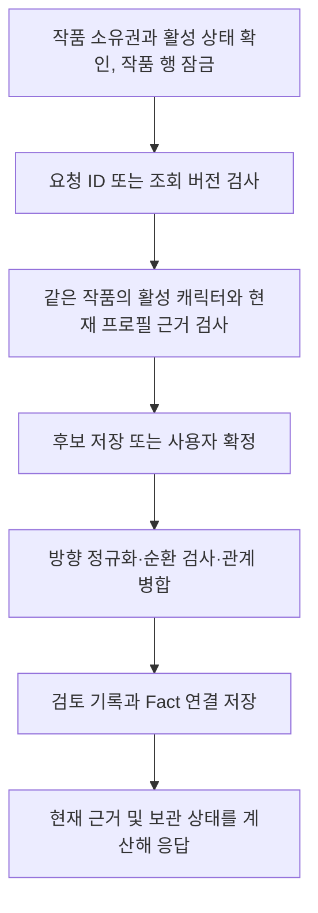

# 가족 관계 v1 — GH259

[이슈 #259](https://github.com/catchhole-soma/catchhole-backend-java/issues/259)의 PostgreSQL 저장 모델, 검토 규칙과 사용자 API다. 기존 캐릭터 추출 프롬프트·출력·승격 흐름은 변경하지 않는다. 현재 프로필에서 후보를 생성하는 자동 처리 및 검토 화면은 [#260](https://github.com/catchhole-soma/catchhole-backend-java/issues/260), 가계도 배치는 [#261](https://github.com/catchhole-soma/catchhole-backend-java/issues/261)에서 연결한다.

## 입력과 검토 경계

관계 입력은 `WorkCharacter`의 실제 현재 PROFILE 슬롯과 `CharacterSnapshotSource` 양쪽에 존재하는 Fact에 한정한다. 전체 Fact 이력, `HISTORY_ONLY` Fact, 비어 있는 슬롯에 남은 provenance는 입력으로 쓰지 않는다. 현재 슬롯이 여러 Fact를 병합한 값이면 각 Fact의 예전 값 대신 **현재 슬롯 전체** `{factValue, valueJson}`를 읽는다. 직접 수정한 설정도 새로운 현재 Fact를 통해 사용할 수 있다.

`GET relationship-sources?characterId=...`는 해당 캐릭터의 현재 PROFILE Fact별로 `factId`, `characterId`, `factKey`, `currentValue`, `contextToken`, `hasEvidence`, `manuallyEdited`를 제공한다. `contextToken`은 현재 슬롯 표시값·구조화 값 및 해당 슬롯 전체 source Fact ID 집합의 SHA-256이다. JSON 객체 key와 출처 ID의 순서는 정규화하며, 다른 슬롯의 변경은 이 토큰을 바꾸지 않는다. 한 슬롯에 여러 Fact가 기여하면 모두 같은 토큰을 갖는다.

서버는 자연어에서 친족 의미를 새로 추론하지 않는다. 후보 작성자가 현재 설정에서 명시된 관계만 지정하고, 작품 소유자가 확인해야 확정한다. `assertion=ASSERTED`라고 전송하는 것만으로 자동 확정되지는 않는다. 각 근거는 해당 관계를 독립적으로 뒷받침하는 현재 슬롯이어야 한다. 여러 문장을 조합해야만 성립하는 추론이나 만남만으로 관계를 만드는 동작은 이번 계약에 포함하지 않는다.

## 저장 모델

| 테이블 | 저장 내용 / 제약 |
| --- | --- |
| `character_relationships` | 같은 작품의 양 끝점, 정규화한 유형·세부 유형·서사 시점·기간 설명, 철회 여부, 버전. 비철회 `(work_id, canonical_key)` partial unique |
| `relationship_candidates` | 원래 방향의 관계 명제, 미해결 호칭, 주장 상태, PENDING/CONFIRMED/DISMISSED, 확정 관계 ID, 정정 이전 관계 ID, 멱등 요청 ID/hash, 버전 |
| `relationship_evidence` | 후보와 Fact FK, 검토한 슬롯 토큰. `(candidate_id, source_fact_id)` unique. 원문·인용문·S3 key는 복사하지 않음 |

관계의 지지 근거는 CONFIRMED 후보에 연결된 evidence에서 조회한다. 후보 하나의 근거 목록은 중복 Fact를 허용하지 않는다. 다른 검토 후보가 같은 Fact와 토큰을 재확인한 이력은 보존하지만, 관계 응답에서는 `(sourceFactId, sourceToken)`을 한 번만 표시한다. 대표 `candidateId`는 UUID 문자열 오름차순으로 선택한다.

## 관계 정규화

| 입력 | 저장 / 판단 |
| --- | --- |
| A PARENT_OF B / B CHILD_OF A | A → B PARENT_OF 하나로 정규화 |
| A SPOUSE B / B SPOUSE A | UUID 문자열 순으로 양 끝점을 정렬한 대칭 관계 |
| A SIBLING B / B SIBLING A | UUID 문자열 순으로 양 끝점을 정렬한 대칭 관계 |
| 부모·자녀 세부 유형 | UNSPECIFIED, BIOLOGICAL, ADOPTIVE, STEP |
| 형제·자매 세부 유형 | UNSPECIFIED, BIOLOGICAL, FULL, HALF, ADOPTIVE, STEP |
| 배우자 세부 유형 | UNSPECIFIED |

`BIOLOGICAL` 형제는 친형제임만 알려졌다는 뜻이며 부모 양쪽을 공유하는 `FULL`로 추정하지 않는다. 모르는 부모·배우자·형제를 생성하거나 부모를 최대 두 명으로 제한하지 않는다. 형제 관계로 부모를 역산하지 않는다. 한쪽 프로필의 명시적인 배우자 설정만으로 대칭 관계를 확정할 수 있으며, 상대 프로필의 중복 확인을 요구하지 않는다. 짝사랑·우정·적대 등 비가족 감정은 v1 유형이 아니다.

관계 식별키는 **정규화한 양 끝점 + 유형 + 세부 유형 + temporalScope + timeLabel** 전체로 만든다. 같은 두 사람이라도 친부모/양부모, 현재/과거, 명시된 기간이 다르면 별도 관계다. timeLabel은 앞뒤 공백만 제거하고 의미적 동치 비교를 하지 않는다. 서로 다른 명제가 모두 사실일 수 있으므로 유형 차이만으로 모순이라고 추정하지 않는다.

자기 관계는 400으로 거절한다. 부모 그래프의 순환은 확정 시 409로 거절한다. 보관·근거 복구로 나중에 순환이 생기면 순환에 속한 관계를 REVIEW_REQUIRED로 표시한다. 이 간선도 다음 확정의 순환 검사에는 포함하여 검토 상태를 이용한 우회를 막는다. 순환 검사는 실제 시점 순서를 추정하지 않고, 현재 근거가 있는 비철회 부모 관계 전체에 적용한다.

## 상태와 시점

세 축을 분리한다.

- 후보 검토: `PENDING → CONFIRMED` 또는 `PENDING → DISMISSED`. 확정/제외 후보는 재편집하지 않는다.
- 서사 시점: `CURRENT`, `HISTORICAL`, `UNKNOWN`. 정확한 시작 시점을 모른다는 이유만으로 UNKNOWN은 아니다. 현재 관계임이 명시되면 CURRENT와 `timeLabel=null`을 사용한다. 실제 관계 시점이 불명확한 UNKNOWN은 검토를 유지한다.
- 현재 사용 가능성: `VALID`, `REVIEW_REQUIRED`, `ARCHIVED_ENDPOINT`, `WITHDRAWN`. 근거 소실과 사용자 철회를 작품 속 이혼·사망·관계 종료로 해석하지 않는다.

상대 ID가 없으면 `objectMention`을 남겨 PENDING으로 보관한다. 동명이인이나 이름 문자열로 자동 연결하지 않는다. `UNCERTAIN`, `NEGATED`, `FIGURATIVE`, `CONFLICTING` 주장, UNKNOWN 시점, 미해결 상대는 확정할 수 없다. 후보 수정 API로 최신 근거와 함께 사용자 검토 결과를 반영한 뒤 확정한다. HTTP 409의 `error.context.reviewReasons`와 후보의 `reviewReasons`를 사용하며 메시지 문자열을 파싱하지 않는다. 부모 순환 등 확정 직전 검증은 추가로 수행하므로 빈 reviewReasons가 확정 성공을 보장하지 않는다.

`createdAt`은 시스템에 등록한 시각이다. Fact의 발견 회차는 기존 Fact 근거 API에서 확인하며 관계 시작 시점으로 바꾸지 않는다. `visibleInFamilyTree`는 `validity=VALID && temporalScope=CURRENT`일 때만 참이다. 관계 목록은 과거·철회·보류 항목도 포함한다. #261은 기본 가계도에 이 플래그를 적용하고, 별도의 이력/검토 화면에서는 원래 항목을 사용한다.

## 변경 및 근거 생명주기

### 상세 처리 기준

- 모든 쓰기는 기존 설정 변경과 같은 Work 행 잠금 안에서 재검증한다. 서로 다른 후보가 동시에 같은 관계를 확정해도 한 관계에 근거만 추가한다. PostgreSQL partial unique가 DB의 중복 방어선이다.
- 생성·후보 수정·확정 시에는 전송된 근거 **모두** 현재 토큰과 일치해야 한다. 이후 관계를 읽을 때는 독립된 현재 근거 하나라도 남아 있으면 VALID다. 마지막 근거가 사라져야 REVIEW_REQUIRED가 된다. 한 병합 슬롯에서 출처 목록이 바뀌면 슬롯 해석도 달라질 수 있으므로 그 슬롯의 모든 이전 토큰을 무효화한다. 다른 슬롯/캐릭터의 독립 근거에는 영향을 주지 않는다.
- 캐릭터 보관은 관계를 삭제하지 않는다. 보관된 끝점이 있으면 ARCHIVED_ENDPOINT로 표시한다. 복구하면 현재 근거와 순환을 재계산한다. 보관 캐릭터의 Fact 근거 API는 기존 규약대로 사용할 수 없다.
- 회차/설정집 원문 파기는 확정 Fact와 현재 설정을 보존한다. 원문 인용이 사라지면 hasEvidence=false가 되지만 슬롯과 출처 ID가 같으면 토큰과 관계는 유지한다. 설정을 수정해 현재성이 사라진 **활성 캐릭터의 과거 Fact**는 원문이 남아 있는 동안 `current=false, hasEvidence=true`로 다시 검토할 수 있다. 실제 원문 제공과 파기 대기 상태 제어는 기존 Fact evidence API가 담당한다.
- 관계 정정은 기존 row의 끝점/유형을 덮지 않는다. 기존 관계를 철회하고, 새 현재 근거로 새 후보를 확정한다. 같은 canonical 내용도 새 관계로 재확인할 수 있다. 다른 비철회 관계와 내용이 같으면 그 관계에 새 근거를 추가한다. 실패하면 철회와 새 후보를 함께 롤백한다.
- 작품 영구 삭제 및 이를 사용하는 회원 탈퇴 경로는 evidence → candidate → relationship → snapshot source → Fact 순서로 삭제한다. 원문과 별개로 관계 개인 데이터도 함께 삭제된다.

현재 읽기는 관계별 비동기 stale flag를 저장하지 않고 작품의 관계·근거를 묶어서 조회해 사용 가능성을 계산한다. 순환 검사를 위해 목록의 페이지와 별개로 작품의 전체 관계 그래프를 읽는다. 작품당 관계 규모가 커지면 이 전체 조회와 가계도 전용 조회의 한도를 측정한 뒤 조정한다. 이번 변경에서 새로운 추출 작업, LLM 호출, 백그라운드 관계 갱신은 추가하지 않는다.

## HTTP 계약

모든 경로 앞에 `/api/v1/works/{workId}`가 붙으며 JWT와 작품 소유권이 필요하다. 성공은 기존 `CommonResponse.data`, 목록은 `PageResponse`다. 목록은 `createdAt DESC, id DESC`, page 기본 0, size 기본 20/최대 100이다.

| 메서드 / 경로 | 입력 / 결과 |
| --- | --- |
| GET `/relationship-sources?characterId=...` | 현재 프로필 입력과 토큰 |
| POST `/relationship-candidates` | requestId + 명제 + evidence → PENDING 후보 |
| GET `/relationship-candidates` | 전체 검토 후보 페이지 |
| GET `/relationship-candidates/{id}` | 후보·근거·보류 사유 |
| PUT `/relationship-candidates/{id}` | expectedVersion + 명제 + evidence → PENDING 수정 |
| POST `/relationship-candidates/{id}/confirm` | expectedVersion → 확정 후보·관계 ID |
| POST `/relationship-candidates/{id}/dismiss` | expectedVersion → 제외 후보 |
| GET `/relationships` | 전체 관계 페이지·현재 유효성 |
| GET `/relationships/{id}` | 정규화한 관계 상세 |
| GET `/relationships/{id}/evidence` | 중복 제거한 Fact 참조·원문 조회 경로 |
| PUT `/relationships/{id}` | expectedVersion + requestId + 명제 + evidence → 대체 확정 관계 |
| POST `/relationships/{id}/withdraw` | expectedVersion → 철회된 기존 관계 |

명제 필드는 `subjectCharacterId`, nullable `objectCharacterId`/`objectMention`, `kind`, `subtype`, `temporalScope`, nullable `timeLabel`, `assertion`이다. 근거는 1~20개이며 각 항목은 `{sourceFactId, sourceToken}`이다. 토큰은 source API에서 받은 값을 그대로 전송한다. 전체 예시 및 양방향 정규화 fixture는 [공유 계약 JSON](contracts/family-relationships-v1.json)에 있다.

생성 requestId는 작품 안에서 유일하다. 같은 ID와 같은 원래 입력은 현재 후보 상태를 돌려준다. 후보가 수정/제외/확정된 뒤 재전송되어도 원래 상태로 되돌리지 않는다. 같은 ID에 다른 내용은 `RELATIONSHIP_IDEMPOTENCY_CONFLICT`다. 정정 requestId도 같은 공간을 사용하며 대상 관계 ID와 expectedVersion까지 hash에 포함한다.

후보는 version 0으로 시작하고 수정/결정마다 증가한다. 확정/제외 재시도는 해당 결정을 내린 **직전 버전**만 멱등 성공한다. 관계 버전은 새 지지 후보가 확정될 때마다 증가하고 철회 시에도 증가한다. 따라서 첫 확정 관계 버전은 1이다. 정정/철회는 응답에서 받은 실제 버전을 사용해야 한다. 근거 변경은 관계 버전과 별도로 sourceToken으로 검증한다.

주요 오류는 400 `RELATIONSHIP_INVALID_RELATIONSHIP`/`RELATIONSHIP_INVALID_SOURCE`, 409 `RELATIONSHIP_STALE_SOURCE`/`RELATIONSHIP_STALE_VERSION`/`RELATIONSHIP_REVIEW_REQUIRED`/`RELATIONSHIP_ANCESTRY_CYCLE`이다. 다른 소유자의 작품은 기존 WORK_NOT_FOUND 404로 숨긴다. Swagger의 `Relationship` 그룹이 DTO와 operationId의 기준이다.

## 검증과 후속 연결

단위 테스트는 현재 슬롯/출처 교집합, 토큰 정규화, 원문 파기, 순환 복구와 근거 응답을 검증한다. MockMvc 테스트는 실제 인증·JPA로 방향 중복, 후보 검토, 수정·멱등 재시도, 여러 근거, 보관·복구, 동시 확정, 정정/철회 및 작품 삭제를 확인한다. 동일 테스트를 격리된 `pgvector/pgvector:0.8.2-pg16` Testcontainer에서 실행해 Flyway V84와 JPA validate도 검사한다. 공유/운영 DB는 사용하지 않는다.

#260의 자동 후보 생성은 위 source 경계와 requestId 계약을 소비한다. 현재 사용자 API는 소유자의 명시적 작성·검토 경로다. Worker 저장 경계나 내부 인증은 후속 연계에서 결정하며 기존 SettingCandidate 생성 책임을 옮기지 않는다. #261은 canonical PARENT_OF를 위→아래, SPOUSE/SIBLING을 대칭 간선으로 해석하고, 원문이나 Fact를 다시 읽어 임의의 간선을 만들지 않는다.

### 2026-10-17 구현 검증 결과

- `./gradlew test bootJar --console=plain`: 전체 3,091건 중 2,855건 통과, 236건 건너뜀, 실패 0건. 새 저장소 의존성을 반영하도록 기존 DB 없는 기동 테스트의 mock 등록도 보완했다.
- 입력 검증 메시지를 한국어로 정리한 최종 상태에서 `./gradlew test --tests '*relationship.*' bootJar --console=plain`: 관계 테스트 76건 전부 통과, 건너뜀 0건. PostgreSQL API 26건에 Flyway/JPA validate 검증이 포함된다.
- 원문에서 관계를 생성하는 자동 처리와 가계도 화면은 후속 #260/#261의 범위다. 이번 계약은 사용자 명시적 확정을 기본으로 하며 추가 자동 확정 정책은 도입하지 않았다.
